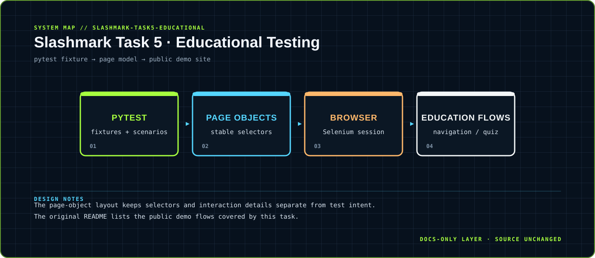

<div align="center">



</div>

# Slashmark Task 5 · Educational Testing

> Browser automation for learning flows, navigation and interactive quiz surfaces.

A Python + Selenium + pytest suite organized around page objects and repeatable educational-site scenarios.

<div align="center">

`Python · Selenium · pytest` &nbsp;·&nbsp; `test scenario → page object → browser interaction → assertion`

</div>

## `01 / SYSTEM CARD`

- **Primary boundary:** `pytest fixture → page model → public demo site`
- **Documentation stance:** architecture and presentation only; application source is intentionally untouched.
- **Visual language:** Y2K terminal grid, brutalist labels, maximalist contrast, readable static SVG fallback.

## `02 / ARCHITECTURE`

The map above is a compact view of the repository's visible runtime boundary. It is designed to answer three questions quickly: where input enters, where policy or domain logic lives, and where external side effects leave the system.


## `03 / DESIGN NOTES`

- The page-object layout keeps selectors and interaction details separate from test intent.
- The original README lists the public demo flows covered by this task.

This upgrade adds documentation assets only. It does not change source files, dependency manifests, tests, workflows or runtime configuration.

## `04 / EXISTING PROJECT DOCUMENTATION`

<details open>
<summary>Read the original project notes</summary>

# Task 5 — Educational Website Automation Testing

Automated test suite for educational and interactive web pages using Python + Selenium + pytest. Uses real, publicly available demo sites that work reliably.

## What's Tested

- **Enrollment / Navigation** — W3Schools page loading, sidebar, tutorial links, search, footer
- **Quiz Submissions** — W3Schools HTML quiz form, radio button selection, form submission, question flow
- **Progress Tracking** — W3Schools HTML5 `<progress>` element value, max, and percentage
- **Multimedia & Interactions** — W3Schools video player, iframe switching, image gallery; herokuapp dropdown selection, checkbox states, dynamic content loading

## Target Sites

| Feature | URL |
|---|---|
| Login | `https://the-internet.herokuapp.com/login` |
| Enrollment (W3Schools) | `https://www.w3schools.com` |
| Tutorial Sidebar | `https://www.w3schools.com/html/` |
| Quiz | `https://www.w3schools.com/quiztest/quiztest.asp?qtest=HTML` |
| Progress Bar | `https://www.w3schools.com/tags/tryit.asp?filename=tryhtml5_progress` |
| Video | `https://www.w3schools.com/html/html5_video.asp` |
| Iframe | `https://www.w3schools.com/tags/tryit.asp?filename=tryhtml_default` |
| Image Gallery | `https://www.w3schools.com/css/tryit.asp?filename=trycss3_image_gallery` |
| Dropdown | `https://the-internet.herokuapp.com/dropdown` |
| Checkboxes | `https://the-internet.herokuapp.com/checkboxes` |
| Dynamic Loading | `https://the-internet.herokuapp.com/dynamic_loading/1` |

## Setup

```bash
python3 -m venv venv
source venv/bin/activate
pip install -r requirements.txt
```

## Run Tests

```bash
# All tests
pytest

# By category
pytest -m smoke
pytest -m educational
pytest -m multimedia

# Headless mode
HEADLESS=true pytest

# Generate HTML report
pytest --html=reports/report.html --self-contained-html
```

## Project Structure

```
pages/
  base_page.py              — BasePage with find, click, type_text, is_visible
  educational/
    login_page.py           — the-internet.herokuapp.com/login
    enrollment_page.py      — w3schools.com navigation & content
    quiz_page.py            — w3schools.com HTML quiz (overlay handling via JS)
    progress_page.py        — w3schools.com HTML5 progress element
    multimedia_page.py      — video, iframe, gallery, dropdown, checkbox, dynamic loading
tests/
  task5_educational/
    test_enrollment.py
    test_quiz.py
    test_progress.py
    test_multimedia.py
conftest.py                 — Chrome driver fixture + screenshot on failure
```

## Tech Stack

- Python 3 + Selenium 4 + pytest
- Page Object Model design pattern
- WebDriver Manager for automatic browser driver management

## Intern

**M Vignesh Sai** — Slash Mark Internship (June 2026)

</details>

